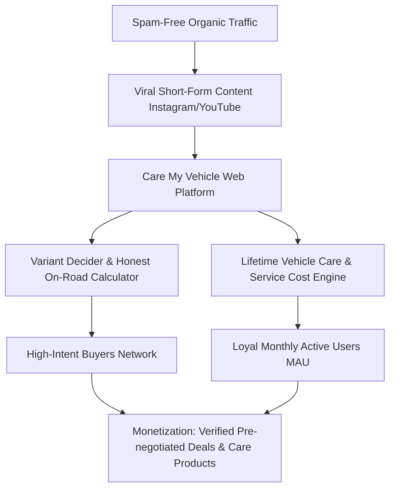
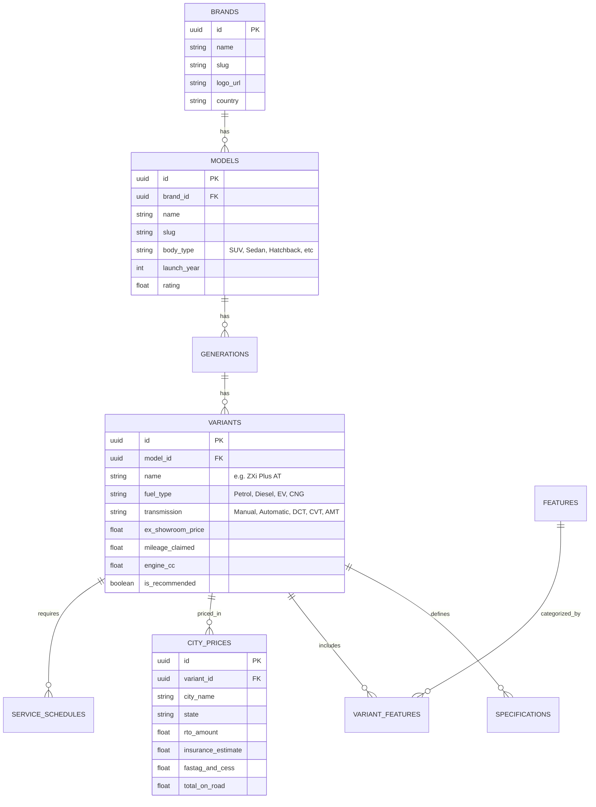

# Care My Vehicle 🚗💨
> Complete Master Strategic Blueprint, Instagram Brand Kit, Competitor Deconstruction & Platform Growth Playbook.

---

## 📌 Executive Summary
**Care My Vehicle** is positioned to disrupt legacy Indian automotive aggregators (**CarDekho, CarWale, 91Wheels, Cars24**). 

> **⚡ Phase 1 Lean Startup Focus:** We start by dominating **Every Newly Launched Car Model & Variant** with unmatched granular detail (every variant, ex-showroom & on-road pricing, engine specs, dimensions, feature differences, and VFM recommendations). Once traction and audience are established, we extend into full-lifecycle ownership care and used car tools.
>
> 📖 **Dedicated Playbooks:**
> - [NEW_LAUNCHES_PLAYBOOK.md](file:///d:/caremyvehicle/NEW_LAUNCHES_PLAYBOOK.md) — The exact 8-pillar specification template & Instagram launch workflow.
> - [sample_launch_example.md](file:///d:/caremyvehicle/sample_launch_example.md) — Live real-world example: Mahindra Thar Roxx (All variants & details).

---

## 🎨 Part 1: Instagram Brand Kit & Launch Asset

### 1.1 Recommended Instagram Handles (`@username`)
Here are the prioritized handle choices based on availability and searchability:

| Priority | Handle | Vibe / Purpose |
|---|---|---|
| **#1 Choice (Primary)** | `@caremyvehicle` | Cleanest, maximum brand equity |
| **#2 Choice (India-Focused)** | `@caremyvehicle.in` | Localized, high trust for Indian car buyers |
| **#3 Choice (Official)** | `@caremyvehicle_official` | Authoritative & verified feel |
| **#4 Choice (Community)** | `@caremyvehicleclub` | High engagement community angle |
| **#5 Choice (Action-Oriented)** | `@gocaremyvehicle` | Modern tech startup feel |

---

### 1.2 Instagram Name (Display Name - Search Optimized)
> *Note: Instagram indexes words in the Name field for search!*

- **Option A (Recommended for SEO & Discovery):**  
  `Care My Vehicle | Car Guide & Prices 🚗`
- **Option B (Comparison & Buying Focus):**  
  `Care My Vehicle 🚘 Car Variants & Care`
- **Option C (Short & Punchy):**  
  `Care My Vehicle | Auto Advisor`

---

### 1.3 The Best Instagram Bios (Under 150 Characters — Website Included)

#### 🏆 Option 1: The Authority Launch Bio (137 Characters / 143 UTF-16) — RECOMMENDED
```text
🏎️ New Car Launches in India 🇮🇳
📊 All Variants & On-Road Prices
🎯 Best Variant to Buy Picks
❌ Zero Spam • Honest Specs 👇
caremyvehicle.in
```

#### Option 2: The Radar & VFM Focus (135 Characters / 140 UTF-16)
```text
🚗 India's New Car Launch Radar
📋 Every Variant & Real On-Road Price
💡 Best Variant to Buy Guides
🛡️ Zero Dealer Spam 👇
caremyvehicle.in
```

#### Option 3: Short, Punchy & Minimalist (128 Characters / 132 UTF-16)
```text
🏎️ Every New Car Launch & Variant
📊 Real City On-Road Prices & Specs
🎯 Which Variant to Buy? Guides
❌ 0% Spam 👇
caremyvehicle.in
```

---

### 1.4 Profile Picture & Brand Identity (Clean Light Consumer Brand)

#### Why Competitor Logos Succeeded:
Brands like **CarDekho, Cars24, Spinny, and CarWale** use **crisp, pure white backgrounds** with bold, vibrant royal blue and coral/red accents. Light colors feel open, welcoming, transparent, and approachable to millions of car buyers.

#### The Care My Vehicle Brand Mark:
- **Background:** Crisp Pure White (`#FFFFFF`).
- **Symbol:** A bold, modern aerodynamic car silhouette in **Electric Royal Blue (`#2563EB`)** with a sky-blue tinted glass cabin and an energetic **Sunrise Coral Red (`#EF4444`)** road speedline.
- **Active Default Profile Image:** [`profile_image.jpg`](file:///d:/caremyvehicle/profile_image.jpg) *(Master asset: [`brand_identity/instagram_profile_icon.png`](file:///d:/caremyvehicle/brand_identity/instagram_profile_icon.png))*.
- **Interactive Showcase:** Open [`brand_identity/preview.html`](file:///d:/caremyvehicle/brand_identity/preview.html) in your browser.

---

### 1.5 Instagram Content Strategy (To get first 50k Followers)

#### Core Content Pillars (30-60s Reels & Carousels):
1. **"Don't Buy This Variant, Buy That" (Variant Decider Series):**
   - *Example:* "Why Creta SX is a waste of money over S(O) variant"
   - *Example:* "XUV 700 AX5 vs AX7: Rs 2.5 Lakh extra worth it or not?"
2. **"True On-Road Price Breakdown":**
   - Reveal the real price vs dealer quote. Expose dealer insurance markups, mandatory accessory scams, handling charges (illegal RTO charges).
3. **"5-Year Service & Maintenance Reality Check":**
   - What will this car actually cost you to maintain every 10,000 km? (Parts pricing, oil change, periodic wear & tear).
4. **"Hidden Car Features & Easter Eggs":**
   - Obscure features of popular cars (Nexon, Punch, Scorpio-N, Brezza, Grand Vitara, Thar).
5. **"Car Care & Diagnostic Secrets":**
   - How to read engine check lights, AC cleaning hacks, battery life extension, detailing tips.

---

## 🔍 Part 2: Deep Competitor Analysis (CarDekho, CarWale, 91Wheels, Cars24)

### 2.1 The Competitive Landscape

| Feature / Metric | CarDekho | CarWale | 91Wheels | Cars24 | **Care My Vehicle (Opportunity)** |
|---|---|---|---|---|---|
| **Core Revenue Model** | Selling user leads to dealers & loan aggregators | Lead gen & brand display ads | Affiliate & media ads | Direct car sales margin & financing | Subscription, transparent marketplace & care services |
| **User Privacy** | 🔴 Low (aggressive telecaller spam upon quote request) | 🔴 Low (sold to multiple dealers) | 🟡 Medium | 🔴 High sales push calls | 🟢 **100% Zero-Spam / Anonymous Pricing** |
| **Variant Comparison** | Good, but cluttered | Good, classic spec tables | Clean UI, but surface level | Focused on used cars | 🟢 **Algorithmic "Value-For-Money" Score** |
| **Post-Purchase Care** | Weak / Outdated blogs | Basic service center directory | Almost non-existent | Basic warranty packages | 🟢 **Core Focus: Service Log, DIY Care, Parts Cost** |
| **Price Transparency** | Approximate (lacks dealer discount data) | Standard formula (often off by 5-10%) | Generic ex-showroom | Only used car asking prices | 🟢 **Itemized Quotation Inspector & Real Quotations** |
| **Site Speed & UX** | Heavy ads, slow mobile experience | Cluttered with banners | Clean, but low interactivity | App-first, desktop weak | 🟢 **Sub-second Next.js / PWA Lightning Speed** |

---

### 2.2 The Big User Frustrations & How Care My Vehicle Wins

#### 1. The "Spam Call" Nightmare (Our #1 Growth Lever)
- **Problem:** Every time someone visits CarDekho or CarWale to check "On-Road Price in My City", they are forced to enter their mobile number + OTP. Within 10 minutes, they receive 5-8 aggressive calls from local car dealerships and loan brokers.
- **Care My Vehicle Solution:** **No Phone Number Required.** Instant, open city-wise price calculator with city RTO, TCS, fastag, standard vs zero-dep insurance estimates. Users will flock here simply because it doesn't harass them.

#### 2. The "Variant Confusion"
- **Problem:** Modern cars have 25 to 40+ variants (e.g., Tata Nexon, Mahindra XUV 3XO, Hyundai Creta). Buyers get overwhelmed by letters like LXi, VXi, ZXi, Smart, Pure, Creative, Fearless, AX3, AX5, AX7.
- **Care My Vehicle Solution:** **The "Variant Matrix & Feature Diff Engine"**:
  - Highlights *only* what changes between variant A and variant B.
  - Gives a mathematical recommendation: *"Paying ₹1,10,000 extra for Variant B gives you ₹1,65,000 worth of factory equipment. RECOMMENDED."*

#### 3. Neglect of Post-Purchase (Ownership & Care)
- **Problem:** All platforms abandon the customer the second the car is purchased.
- **Care My Vehicle Solution:** Become the lifetime digital glovebox:
  - Service reminder tracker based on odometer.
  - Actual spare parts price catalog (brake pads, clutch plate, bumper, headlights).
  - Common issues & defect radar (e.g., DPF clogging issues in BS6 diesel cars).

---

## 🚀 Part 3: Strategic Blueprint - How to Outgrow the Giants



### 3.1 Growth Vectors (0 to 1 Million Monthly Visitors)

1. **Programmatic SEO (pSEO) at Scale:**
   - Create high-speed automated landing pages for every possible query:
     - `/[brand]/[model]/[variant]-on-road-price-[city]` (e.g., `/tata/nexon/creative-plus-petrol-on-road-price-delhi`)
     - `/[car-a]-vs-[car-b]-maintenance-cost` (e.g., `/brezza-vs-nexon-maintenance-cost`)
     - `/[car]-service-cost-after-5-years`
     - `/[car]-common-problems-and-recalls`
2. **The "Dealer Quote Auditor" Tool:**
   - Users upload a photo or PDF of the proforma invoice given by their local dealer.
   - The AI scans line items and highlights dealer traps:
     - ⚠️ *"Dealer charging ₹48,000 for insurance? You can get HDFC ERGO Zero-Dep for ₹28,000 with same addons (Save ₹20,000)!"*
     - ⚠️ *"Logistics/Handling charges of ₹9,500 flagged: Deemed illegal by Supreme Court/RTO."*
     - ⚠️ *"Mandatory Basic Kit of ₹12,000: You can buy better aftermarket mats & mudflaps for ₹3,500."*
3. **WhatsApp Bot Companion:**
   - Send car name ➔ get instant variant comparison sheet, brochure PDF, and city on-road price directly on WhatsApp in under 3 seconds.

---

## 💻 Part 4: Technical & Data Architecture

### 4.1 Recommended Tech Stack
- **Frontend / Fullstack:** Next.js 15 (App Router, Server Components for near-instant SSR performance and 100/100 Core Web Vitals).
- **Styling:** Modern Vanilla CSS / Tailwind with Dark/Light mode support.
- **Database:** PostgreSQL (Supabase or Neon Serverless) for relational schema (Cars, Specs, Pricing).
- **Search Engine:** Meilisearch or Algolia (instant sub-15ms fuzzy search for car names, variants, and specs).
- **ORM:** Prisma or Drizzle ORM for type-safe database queries.
- **CMS / Admin Panel:** Built-in custom admin or Strapi to easily update monthly prices, new vehicle launches, and specs.

---

### 4.2 Comprehensive Database Schema (Relational Design)



---

## 📅 Part 5: Actionable 30-Day Execution Roadmap

| Phase | Timeline | Key Deliverables |
|---|---|---|
| **Phase 1: Brand & Social Setup** | Day 1 - 5 | • Claim Instagram, YouTube, X handles<br>• Upload official logo & set up bio<br>• Publish first 5 "Variant Battle" Reels |
| **Phase 2: Database & Core Models** | Day 6 - 12 | • Populate Top 20 best-selling cars in India (Maruti, Hyundai, Tata, Mahindra, Kia)<br>• Build on-road price calculator engine (all 28 states & major UTs) |
| **Phase 3: Web MVP Launch** | Day 13 - 22 | • Deploy Next.js web application with fast search<br>• Clean variant comparison table<br>• Dealer Invoice Auditor tool |
| **Phase 4: Growth & Distribution** | Day 23 - 30 | • Launch WhatsApp Query Bot<br>• Publish 50 programmatic SEO landing pages<br>• Distribute content across Reddit (r/CarsIndia) and Team-BHP |

---

## 🏆 Part 6: Summary of Files in this Project

1. `profile_image.jpg`: High-resolution official logo & Instagram profile image.
2. `CARE_MY_VEHICLE_STRATEGY.md`: This comprehensive strategic master plan.
3. `data_schema.sql`: SQL migration script ready to execute for the entire vehicle database.
