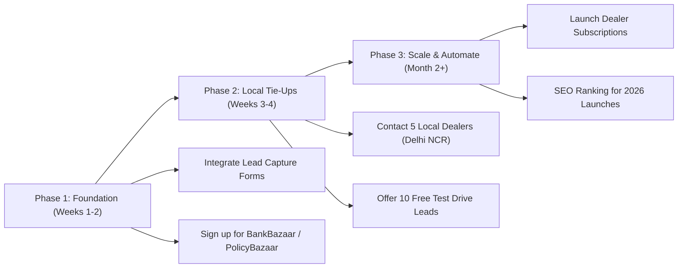

# 💰 Care My Vehicle — Comprehensive Monetization & Revenue Strategy

> **Project Goal**: Transform **Care My Vehicle** from an automotive discovery portal into a high-margin, scalable digital automotive business across new cars, used cars, auto loans, insurance, and car care services.

---

## 📊 Executive Overview: Why Automotive Tech Has High Earning Potential

Automotive transactions in India range from **₹5 Lakh to ₹50+ Lakh**. Because ticket sizes are very high:
- Banks, NBFCs, and insurance companies pay **industry-leading commissions** for qualified leads.
- Dealerships spend aggressive marketing budgets (₹5,000–₹15,000 CAC per customer) to acquire genuine buyers.
- A website with relatively moderate traffic (10,000–50,000 monthly visitors) with high buying intent can generate significant recurring monthly revenue.

---

## 🎯 6 High-Income Monetization Streams

### 1. 🏦 Auto Loans & Financing Leads (Highest Immediate ROI)
- **Target Audience**: Users calculating EMI, comparing variants, or reviewing the On-Road Price breakdown.
- **How It Works**:
  - Integrate a "Check Lowest Loan Interest Rate" or "Check Pre-Approved Loan Eligibility" call-to-action button on On-Road Price and Car Detail pages.
  - Connect user inquiries to affiliate aggregators (e.g., Paisabazaar, BankBazaar) or direct banking partnerships (HDFC Bank, ICICI Bank, SBI, Kotak Mahindra Prime, Bajaj Finserv).
- **Payout Potential**:
  - **₹1,500 – ₹4,500 per approved loan**, or
  - **0.30% – 0.75% of total loan disbursement value** (e.g. ₹10,00,000 loan disbursement = **₹3,000 – ₹7,500 payout per deal**).

---

### 2. 🛡️ Motor Insurance Quotes & Renewals
- **Target Audience**: New car buyers budgeting on-road prices + existing car owners checking car news/used cars.
- **How It Works**:
  - Embed an instant insurance calculator/quote request widget on price breakup modals and detail pages.
  - Partner with insurance brokers / POSP aggregators like PolicyBazaar, Acko, Digit, Turtlemint, or RenewBuy.
- **Payout Potential**:
  - **10% to 15% commission on the Own Damage (OD) premium component**.
  - Average commission: **₹800 to ₹3,500+ per policy sold or renewed**.

---

### 3. 🚗 Dealership Test-Drive & "Get Offers" Lead Generation
- **Target Audience**: Visitors browsing the **"Get Offers on Popular Cars"** and **"Cars by Fuel Type"** sections.
- **How It Works**:
  - When users click "View Offer & Price" or request a city-specific quote, capture user details: *Name, Phone, City/Pincode, Car Model, Purchase Timeline (0-15 days, 1-3 months)*.
  - Establish lead supply agreements with authorized dealer networks in tier-1/tier-2 cities (Maruti Arena/NEXA, Tata Motors, Hyundai, Mahindra, Kia, Toyota).
- **Payout Potential**:
  - **₹250 – ₹800 per verified high-intent test drive lead**.
  - **₹2,000 – ₹5,000 bonus per vehicle delivery/conversion**.

---

### 4. 🔄 Used Cars Dealer Subscriptions & "Sell My Car" Referrals
- **Target Audience**: Visitors browsing the **"Popular Used Cars in India"** and **"Used Cars by City"** sections.
- **How It Works**:
  - **Dealer SaaS / Listing Plans**: Charge multi-brand pre-owned dealerships a monthly subscription to feature their certified inventory (e.g., ₹2,999/mo for 10 listings, ₹7,999/mo for 30 listings).
  - **Sell My Car Referral Hub**: Add a simple "Want to Sell Your Car?" button that connects users to valuation partners (Spinny, Cars24, CarDekho Gaadi Store).
- **Payout Potential**:
  - **₹1,000 – ₹3,000 per car successfully inspected or purchased** by institutional partners.
  - Monthly subscription retainers from local used car dealers.

---

### 5. 🧽 "Care My Vehicle" Detailing, Ceramic Coating & PPF Network
- **Target Audience**: New car buyers looking to protect their car paint, interior, and electronics.
- **How It Works**:
  - Leverage the brand name **"Care My Vehicle"** by adding a dedicated service directory for Paint Protection Film (PPF), Ceramic Coating, Sun Film, and Dashcam installation.
  - Partner with top car detailing studios in Delhi NCR, Mumbai, Bangalore, Pune, etc., on a referral fee basis.
- **Payout Potential**:
  - A standard PPF package costs **₹60,000 – ₹1,30,000**.
  - Detailing studios offer **10% – 15% referral fee** = **₹6,000 – ₹15,000 single customer payout**.

---

### 6. 📰 OEM Launch Sponsorships & Programmatic Display Ads
- **Target Audience**: Organic visitors reading articles, comparison guides, and newly launched car specs.
- **How It Works**:
  - **Google AdSense / Mediavine**: Automated contextual ads placed inside blog posts, review articles, and search results.
  - **Direct OEM Media Buys**: Car manufacturers frequently allocate launch budgets for homepage carousel takeovers, sponsored review articles, and top banner placements.
- **Payout Potential**:
  - **AdSense / Video Ads**: ₹150 – ₹450 RPM (per 1,000 visits for auto niche).
  - **Sponsored Banner Takeover**: ₹25,000 – ₹1,00,000 per brand campaign for 30 days.

---

## 📈 Step-by-Step Execution Plan

### Phase 1: Lead Capture & Immediate Affiliates (Weeks 1–2)
- [ ] Connect a functional lead inquiry modal to the **"View Offer & Price"** buttons.
- [ ] Register with financial and insurance affiliate networks (BankBazaar, PolicyBazaar, Cuelinks, vCommission).
- [ ] Add an "Instant EMI Calculator with Pre-Approved Loan" call-out on the car detail page.

### Phase 2: Regional Dealer Tie-Ups (Weeks 3–4)
- [ ] Identify 5 authorized Maruti, Tata, and Hyundai dealerships in your primary city (e.g., Delhi NCR).
- [ ] Give them 10 verified test-drive inquiries for free as a proof of quality.
- [ ] Convert them into a paid monthly contract (₹10,000/month for guaranteed buyer inquiries).

### Phase 3: Content Expansion & Organic Traffic (Month 2 onward)
- [ ] Publish 3–5 articles per week in **Latest Car Updates & News** targeting long-tail buyer queries (e.g., *"Best EV under 15 Lakh 2026"*, *"Tata Curvv EV vs MG Windsor comparison"*).
- [ ] Optimize meta titles and tags for Google Search rankings.
- [ ] Enable Google AdSense once organic traffic reaches 5,000+ monthly visits.

---

## 📋 Projected Monthly Revenue Model

| Revenue Channel | Target Volume (Monthly) | Avg. Unit Payout | Estimated Monthly Income |
| :--- | :--- | :--- | :--- |
| **Auto Loans (Affiliate/Bank)** | 10 Approved Loans | ₹3,500 | **₹35,000** |
| **Car Insurance (New + Renewals)** | 20 Policies | ₹1,500 | **₹30,000** |
| **Dealer Test-Drive Leads** | 50 Verified Inquiries | ₹400 | **₹20,000** |
| **Sell Car Referrals (Spinny/Cars24)** | 10 Completed Sales | ₹2,000 | **₹20,000** |
| **PPF / Ceramic Detailing Studio Referrals** | 3 Premium Bookings | ₹8,000 | **₹24,000** |
| **Display Ads & Sponsored Placements** | Baseline Ad Traffic | — | **₹15,000** |
| **TOTAL PROJECTED MONTHLY REVENUE** | | | **₹1,44,000 / month** |

---

*Document created for tracking in `D:\caremyvehicle\MONETIZATION_ROADMAP.md`.*

